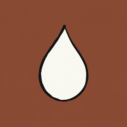
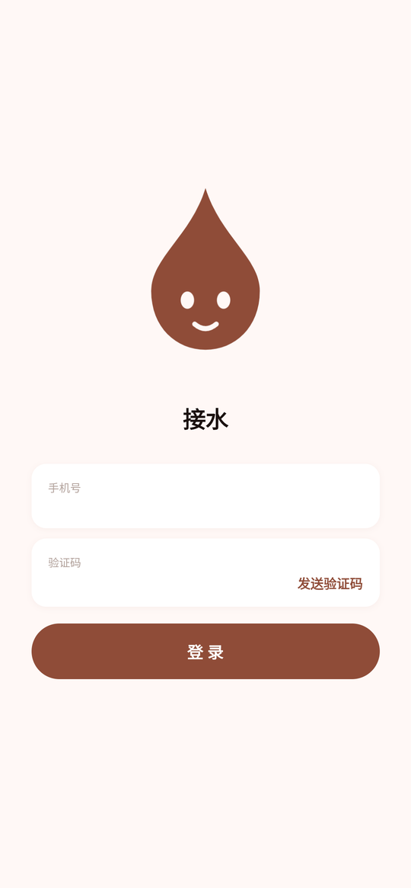
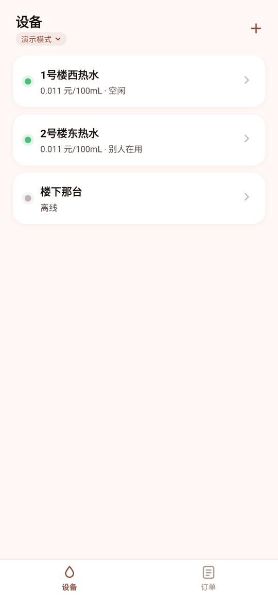
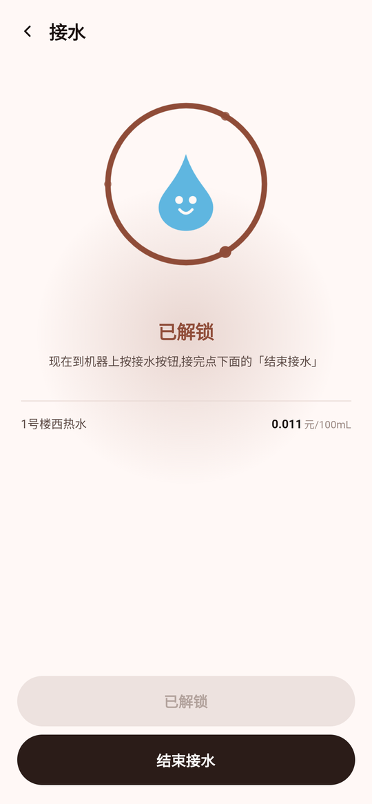
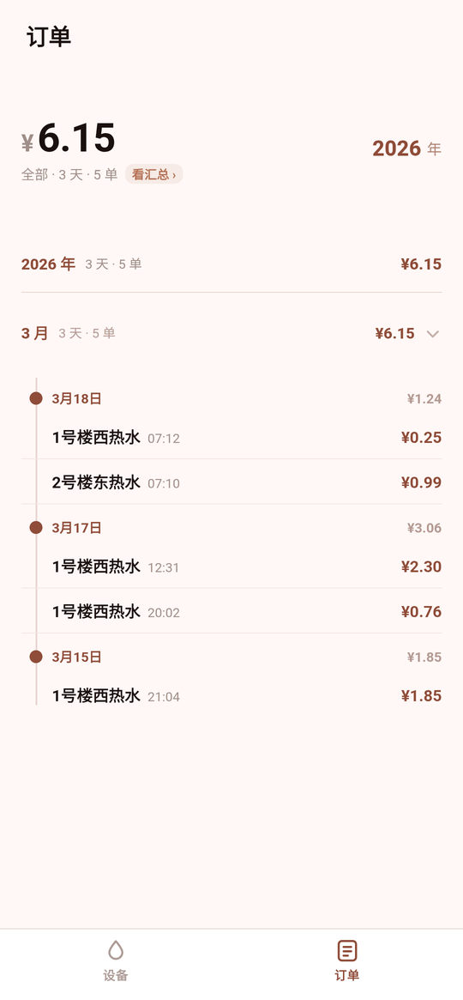

<p align="center">
  
</p>

# 接水

有的学校需用「胖乖生活」App 接水，但这个 App 启动慢、功能杂、广告多。

而很多人只是想接杯水。

这个项目只干两件事：**接水、看账单。**

<p align="center">
  
  
  
  
</p>

## 构建

需要 JDK 17、Android SDK 34、Gradle 8.7。

```bash
cd app
echo "sdk.dir=$PWD/../toolchain/android-sdk" > local.properties
gradle -q assembleDebug
adb install -r app/build/outputs/apk/debug/app-debug.apk
```

## 关于

接口通过反编译官方 App 的 H5 部分得到的，签名密钥来自 [Night-stars-1/wash](https://github.com/Night-stars-1/wash) 。
